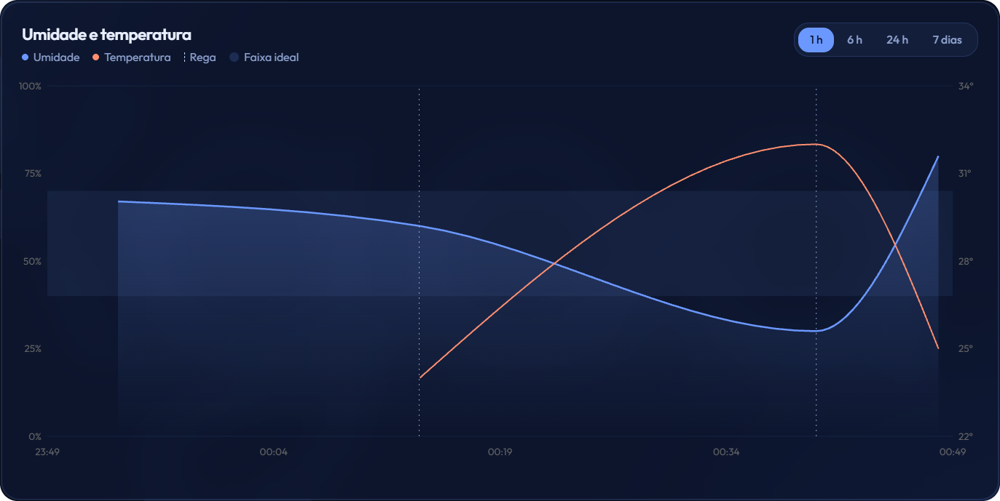
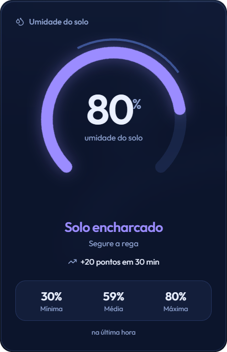
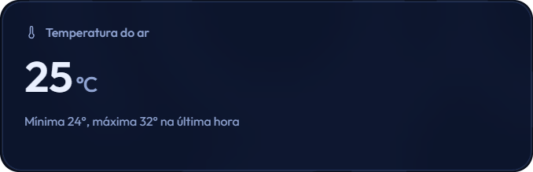
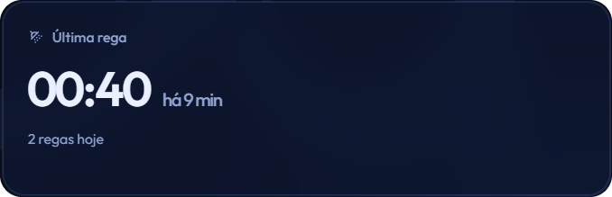
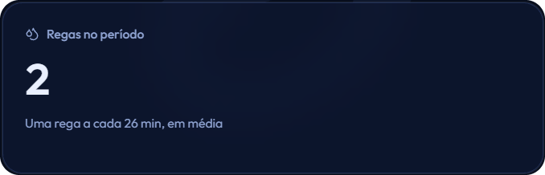
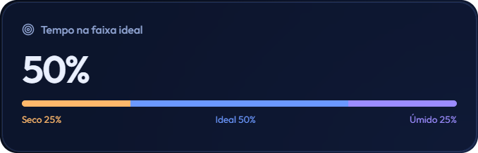
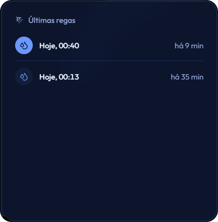

# Agoa

Dashboard de tela única para monitorar a **umidade do solo**, a **temperatura do ar** e as **regas** de uma planta ou horta. Um ESP32 envia as leituras por Wi-Fi, o Next.js grava no Supabase e a tela se atualiza sozinha.

<p align="center">
  
</p>

## O que a tela mostra

| | |
|---|---|
|  | **Medidor de umidade.** Valor atual, status (seco, ideal ou encharcado), tendência dos últimos 30 minutos e mínima, média e máxima do período. |
|  | **Temperatura do ar.** Valor atual com a mínima e a máxima do período. |
|  | **Última rega.** Horário, há quanto tempo foi e quantas regas já aconteceram hoje. |
|  | **Regas no período.** Total de regas e intervalo médio entre elas. |
|  | **Tempo na faixa ideal.** Quanto do período o solo ficou seco, ideal ou encharcado. |
|  | **Últimas regas.** Lista com data, hora e tempo decorrido. |

Também há um indicador no topo que mostra se o ESP32 está online. Se ele ficar mais de 2 minutos sem enviar dados, aparece "Sem sinal".

O gráfico tem seletor de período (1 h, 6 h, 24 h e 7 dias), faixa ideal sombreada e uma linha tracejada em cada rega.

## Tecnologias

- [Next.js](https://nextjs.org/) (App Router)
- [Supabase](https://supabase.com/) para guardar o histórico
- [shadcn/ui](https://ui.shadcn.com/) e [Recharts](https://recharts.org/) para os componentes e o gráfico
- [Tailwind CSS](https://tailwindcss.com/) e [lucide-react](https://lucide.dev/) para estilo e ícones
- Fonte [Outfit](https://fonts.google.com/specimen/Outfit) via `next/font`
- ESP32 enviando as leituras por HTTP

## Como funciona

```
ESP32 ──POST /api/...──▶ Next.js (route.ts) ──▶ Supabase
                                                  │
                          Dashboard (page.tsx) ◀──┘  atualiza a cada 5 s
```

1. O ESP32 lê os sensores e envia um JSON para a rota da API.
2. A rota grava cada valor na tabela correspondente do Supabase.
3. A página consulta o Supabase e atualiza os valores atuais a cada 5 s e o histórico do gráfico a cada 15 s.

## Como rodar

### 1. Instalar

```bash
git clone <url-do-repositorio>
cd <pasta-do-projeto>
npm install
```

Se faltar algum componente do shadcn:

```bash
npx shadcn@latest add card badge button chart
```

### 2. Variáveis de ambiente

Crie um arquivo `.env.local` na raiz:

```env
NEXT_PUBLIC_SUPABASE_URL=https://seu-projeto.supabase.co
NEXT_PUBLIC_SUPABASE_ANON_KEY=sua-chave-anon
```

### 3. Criar as tabelas no Supabase

No **SQL Editor** do Supabase:

```sql
create table historico_umidade (
  id bigint generated always as identity primary key,
  created_at timestamptz not null default now(),
  umidade int4 not null
);

create table historico_temperatura (
  id bigint generated always as identity primary key,
  created_at timestamptz not null default now(),
  temperatura int4 not null
);

create table historico_rega (
  id bigint generated always as identity primary key,
  created_at timestamptz not null default now()
);

-- Como o projeto usa a chave anon, ela precisa poder ler e inserir.
alter table historico_umidade     enable row level security;
alter table historico_temperatura enable row level security;
alter table historico_rega        enable row level security;

create policy "anon le e grava" on historico_umidade     for all to anon using (true) with check (true);
create policy "anon le e grava" on historico_temperatura for all to anon using (true) with check (true);
create policy "anon le e grava" on historico_rega        for all to anon using (true) with check (true);
```

> Essas políticas servem para uso local e testes. Se for publicar na internet, use a `service_role` apenas no servidor (na rota da API) e deixe só a leitura liberada para `anon`.

### 4. Iniciar

```bash
npm run dev
```

Abra [http://localhost:3000](http://localhost:3000).

Para ver o dashboard em outro aparelho da mesma rede (celular, TV), acesse `http://IP-DO-SEU-PC:3000`. Se o Next reclamar de origem bloqueada, rode com `npm run dev -- -H 0.0.0.0`.

## Formato dos dados do ESP32

O ESP32 envia um `POST` com este JSON. Todos os campos são opcionais, e o que vier é gravado:

```json
{ "umidade": 45, "temperatura": 28, "rega": true }
```

| Campo | Tipo | Efeito |
|---|---|---|
| `umidade` | inteiro, 0 a 100 | Grava em `historico_umidade` |
| `temperatura` | inteiro, em °C | Grava em `historico_temperatura` |
| `rega` | `true` | Grava um registro em `historico_rega` |

Exemplo de envio no ESP32 (Arduino):

```cpp
#include <WiFi.h>
#include <HTTPClient.h>

void enviar(int umidade, int temperatura, bool rega) {
  HTTPClient http;
  http.begin("http://IP-DO-SEU-PC:3000/api/SUA-ROTA"); // caminho do seu route.ts
  http.addHeader("Content-Type", "application/json");

  String corpo = "{\"umidade\":" + String(umidade) +
                 ",\"temperatura\":" + String(temperatura) +
                 ",\"rega\":" + (rega ? "true" : "false") + "}";

  int status = http.POST(corpo);
  http.end();
}
```

O computador e o ESP32 precisam estar na mesma rede, e o firewall do computador deve permitir conexões na porta 3000.

## Personalização

No topo do `page.tsx`:

| Constante | O que faz |
|---|---|
| `IDEAL_MIN` e `IDEAL_MAX` | Faixa de umidade considerada ideal (padrão: 40 a 70) |
| `OFFLINE_APOS_MS` | Tempo sem dados para marcar o ESP32 como sem sinal |
| `ATUALIZA_AO_VIVO_MS` e `ATUALIZA_HISTORICO_MS` | Frequência de atualização |
| `COR` | Paleta de cores, baseada no azul da logo (`#6b98ff`) |

A logo fica em `public/logo.svg` e aparece no cabeçalho e como marca d'água no fundo.

## Estrutura

```
agoa/
├── app/
│   ├── api/
│   │   └── sensor/
│   │       └── route.ts      # recebe os dados do ESP32
│   ├── favicon.ico
│   ├── globals.css
│   ├── layout.tsx
│   └── page.tsx              # dashboard (tela única)
├── components/               # componentes locais
│   └── ui/                   # componentes do shadcn/ui
├── hooks/
│   ├── use-highlighted-code.ts
│   └── use-mobile.ts
├── lib/
│   ├── highlighter.tsx
│   └── utils.ts
├── public/
│   ├── logo.svg
│   └── screenshots/          # imagens usadas neste README
├── .env.local                # variáveis do Supabase 
├── .gitignore
├── AGENTS.md
├── components.json
├── eslint.config.mjs
├── LICENSE
├── next-env.d.ts
├── next.config.ts
├── package-lock.json
├── package.json
├── README.md
└── tsconfig.json
```

## Limitações conhecidas

- O histórico lê no máximo 6.000 linhas por tabela. Se o ESP32 enviar a cada poucos segundos, o início do período de 7 dias pode ficar de fora.
- O dashboard só exibe dados. Ainda não envia comandos para ligar a bomba.

## Ideias para o futuro

- Ligar a bomba pelo dashboard, com uma tabela de comandos que o ESP32 consulta periodicamente
- Alertas quando o solo ficar seco por muito tempo
- Mais de uma planta ou sensor
